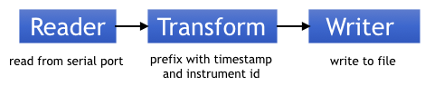
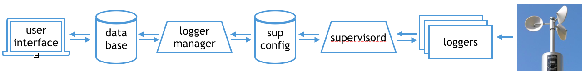

This is the OpenRVDAS Guide: a single, front-to-back manual covering what
OpenRVDAS is, how to run it, install it, configure it for your own vessel,
extend it and fix it when it misbehaves. The outline in the left sidebar is
the outline of the whole Guide; every section expands to show its contents.

The Guide describes OpenRVDAS as of v2.7.0. Where v2.7.0 behaves differently
from earlier releases, the differences are called out in place. It replaces
the earlier collection of standalone pages, which remain available at their
old addresses under [All the Docs]({{ "/docs/" | relative_url }}) until the
Guide has fully absorbed them.

# What Is OpenRVDAS?

OpenRVDAS ("Open Research Vessel Data Acquisition System") is a software
framework for building custom data acquisition systems. It is aimed at
operators of oceanographic research vessels and other science platforms that
need to record streaming data. OpenRVDAS reads data records from serial
ports and network-aware sensors, optionally modifies those records — adding
timestamps, parsing them into named fields, computing derived values — and
streams the results to one or more destinations: logfiles, network ports,
databases and live displays.

Every ship has different requirements, and those requirements change from
mission to mission and year to year, so no single turnkey system can serve
everyone for long. OpenRVDAS instead takes the form of a kit of small,
modular components — Readers, Transforms and Writers — with a simple, common
API, which you snap together into whatever system your situation needs.

OpenRVDAS was written from a clean slate, based on experience developing
data acquisition code for the US Antarctic Program, and heavily informed by
discussion and collaboration with members of the
[RVTEC community](https://www.unols.org/committee/research-vessel-technical-enhancement-committee-rvtec).
It is open source, under active development, and in production use on
research vessels around the world. See the
[About page]({{ "/about/" | relative_url }}) for more on the project's
history and design philosophy.

## What It Isn't

Two boundaries are worth knowing up front:

* **It isn't a turnkey product.** OpenRVDAS ships with working examples and
  sensible defaults, but it expects your institution to describe its own
  sensors, data flows and operating modes in configuration files. The
  payoff for that work is a system that matches your vessel exactly; the
  cost is that someone has to do it. Section
  [5. Setting Up Your Own Vessel]({{ "/guide/your-vessel/" | relative_url }})
  walks through it.
* **It isn't an analysis package.** OpenRVDAS acquires, records and
  displays underway data, and can compute derived values (true winds,
  calibrated temperatures) as it flows past. Quality control, gridding and
  scientific analysis happen downstream, in whatever tools your institution
  already uses.

# How It Works

The core of OpenRVDAS is a dead-simple idea: a data record flows from a
**Reader** (which gets it from a serial port, a UDP port, a file, a
database...), through zero or more **Transforms** (which timestamp it, parse
it, convert or filter it), to one or more **Writers** (which store it in a
logfile, forward it over the network, write it to a database...).

A pipeline of this kind serving a single data stream — one gyroscope, one
anemometer — is called a **logger**. A logger is defined in a few lines of
YAML naming its components and their parameters, and can be run by itself
from the command line with the `listen` command, which is also the tool of
choice for debugging. Loggers typically have several interchangeable
**logger configurations** — for example: `off`, `net` (read and broadcast), `net/file`
(broadcast and record) — describing what the logger should do in different
circumstances.

A **cruise definition** is a YAML file collecting everything the vessel
runs: its loggers, each logger's configurations, and a set of **cruise
modes** — `port`, `underway`, `EEZ` — specifying which configuration each
logger should run in each mode. Change the mode, and every logger moves to
its configuration for that mode.

The **logger manager** turns a cruise definition into a running system: it
starts and supervises the loggers, restarts them if they die, switches
configurations on mode changes, and records what it did. It runs as a
system service, and takes commands three ways: from a web console, from the
command line (`lmcmd`), or programmatically through its API.

OpenRVDAS has two supported **web consoles**, and you choose one at
installation time:

* the **Django console** — the classic interface: stable, full-featured and
  the default;
* the **React console** — a React front end with a FastAPI back end: newer,
  and still marked experimental by the installer.

Both talk to the same logger manager and offer the same essential controls:
load a cruise definition, change modes, start and stop individual loggers,
and watch their status and output. Only one console runs at a time, and an
installed system can switch between them (see the
[switching sidebar]({{ "/guide/installation/#sidebar-choosing-and-switching-between-the-django-and-react-consoles" | relative_url }})
in the Installation section). You can also run with no console at all and
drive everything from the command line.

Two more pieces complete the picture:
* The **cached data server** holds the
latest values of every named data field that loggers send it, and feeds them to
subscribers, such as the console's status displays, dashboard widgets, and other loggers
that compute derived values from raw data. 
* An optional **InfluxDB/Grafana** stack stores the parsed data in a time-series database
and serves graphical dashboards from it.

# How to Read This Guide

Start wherever your situation starts:

* **You're standing watch on a vessel where OpenRVDAS is already
  running** — start with
  [2. Working with a Running Installation]({{ "/guide/running-system/" | relative_url }}).
  It requires no root access and no YAML.
* **You're installing OpenRVDAS on a new machine** — go to
  [3. Installation]({{ "/guide/installation/" | relative_url }}), then run
  the sample cruise in
  [4. Tutorial: The NBP Sample Cruise]({{ "/guide/nbp-tutorial/" | relative_url }})
  to see the whole system move.
* **You're bringing OpenRVDAS up on your own vessel** — after the
  tutorial, work through
  [5. Setting Up Your Own Vessel]({{ "/guide/your-vessel/" | relative_url }})
  in order: institutional repository, cruise definition, loggers, readers,
  parsing.
* **Your system runs and you want more from it** — calibrated and derived
  values are in
  [6. Computed and Calibrated Values]({{ "/guide/computed-values/" | relative_url }});
  databases, dashboards and multi-machine setups in
  [7. Storage, Displays and Distribution]({{ "/guide/storage-displays/" | relative_url }});
  snapshots, journals and automated control in
  [8. Operations and Recordkeeping]({{ "/guide/operations/" | relative_url }}).
* **Something is broken** —
  [9. Troubleshooting]({{ "/guide/troubleshooting/" | relative_url }}).
* **You need to look something up** — the component catalog, API
  reference, YAML primer and glossary are in
  [10. Reference]({{ "/guide/reference/" | relative_url }}).

## Conventions

**Command names.** New in v2.7.0, installing OpenRVDAS puts its
command-line tools on your path under plain names: `listen`,
`logger_manager`, `lmcmd`, `simulate_data`, `config_snapshot` and others.
The Guide uses those names throughout. On installations older than v2.7.0
the same tools exist but must be run as Python scripts from the `openrvdas`
directory:

| The Guide says | Pre-v2.7.0 equivalent |
|---|---|
| `listen ...` | `python logger/listener/listen.py ...` |
| `logger_manager ...` | `python server/logger_manager.py ...` |
| `lmcmd ...` | `python server/lmcmd.py ...` |
| `simulate_data ...` | `python logger/utils/simulate_data.py ...` |

The pattern holds for the rest of the tools: the installed name is the
script's filename without `.py`.

Relatedly, the Guide passes `listen` its configuration file as a plain
argument — `listen gyr1_test.yaml`. If your installation is old, you
may need to spell out the flag: `listen --config_file gyr1_test.yaml`.

Note that all the above commands assume that OpenRVDAS was installed according to instructions, and that the virtual environment created during installation has been activated, as described in
[The Python Virtual Environment]({{ "/guide/installation/#the-python-virtual-environment" | relative_url }}).

**Web consoles.** Where the Guide says "the console" without
qualification, it applies to both the Django and React consoles. Where the
two differ, both are described. Screenshots are of the Django console
unless captioned otherwise.

**Paths.** Examples assume OpenRVDAS is installed in `/opt/openrvdas`,
the installer's default, with institution-specific files in a separate repository, linked into
`/opt/openrvdas/local/` as described in
[Your Institution's Repository and local/]({{ "/guide/your-vessel/#your-institutions-repository-and-local" | relative_url }}).
