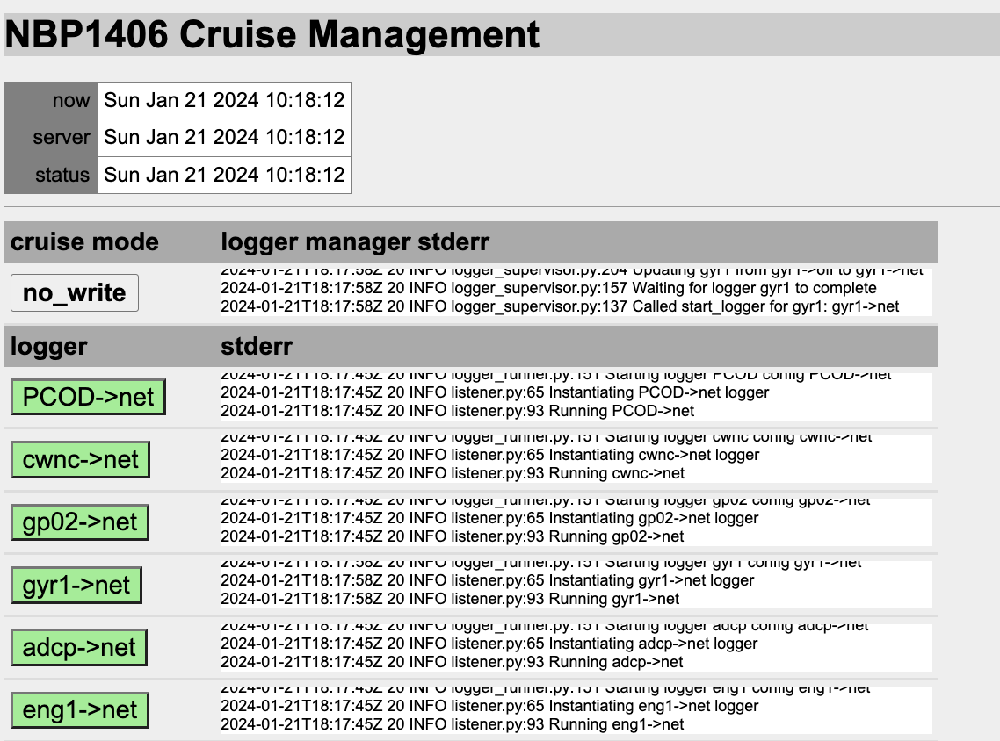
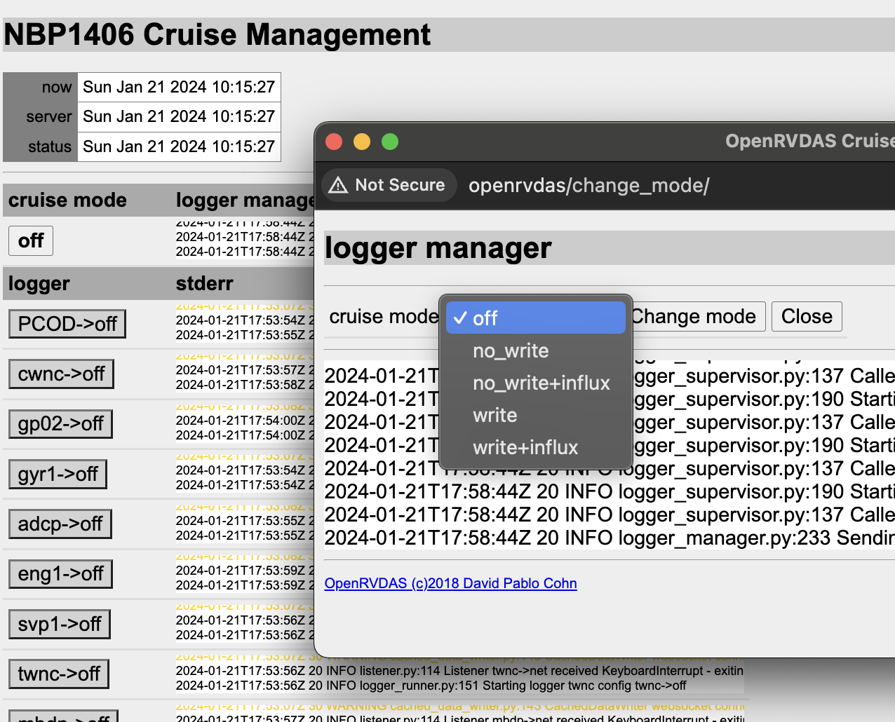
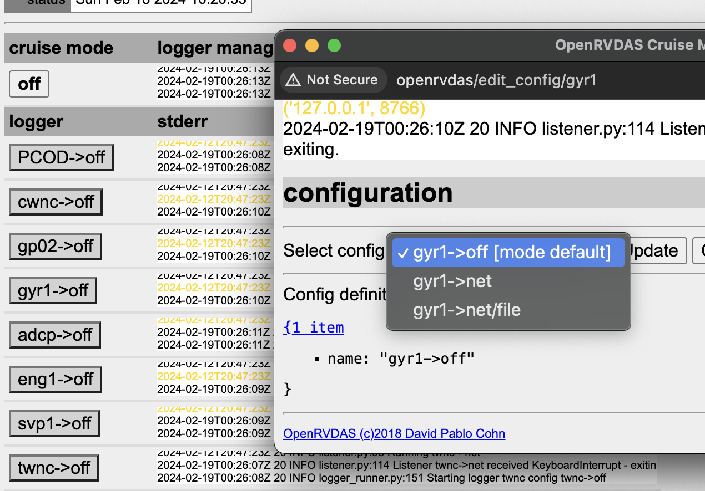
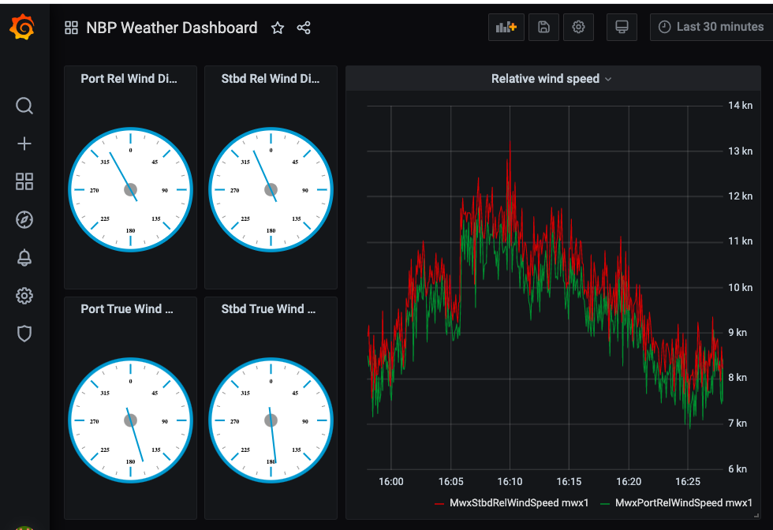
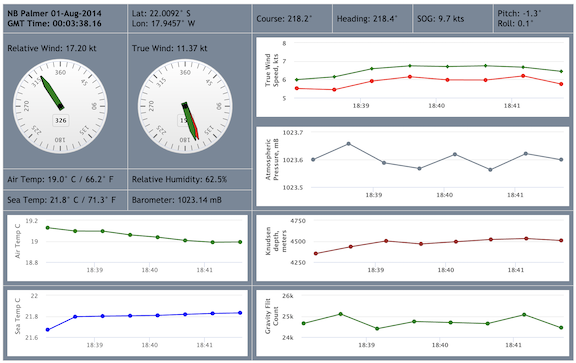

Most people meet OpenRVDAS already running on a ship. This section is the
operator's view — how to use the system through its web console, with no
root access and no YAML. It is also the section to hand a new
watchstander.

It assumes someone has already installed OpenRVDAS (section
[3. Installation]({{ "/guide/installation/" | relative_url }})) and set up
a cruise definition for the vessel (section
[5. Setting Up Your Own Vessel]({{ "/guide/your-vessel/" | relative_url }})).
The screenshots use the NBP sample cruise that ships with OpenRVDAS —
your vessel will have different loggers and mode names, but the controls
are the same.

# The Web Console

Point a browser at the OpenRVDAS machine — `http://openrvdas`, or
whatever your installation's hostname is. You should see the console's
cruise management page:



Your installation runs one of OpenRVDAS's two consoles — Django or React
(see [How It Works]({{ "/guide/introduction/#how-it-works" | relative_url }})).
They look different but offer the same essential controls, and everything
in this section applies to both; as throughout the Guide, screenshots are
of the Django console.

Anyone can view the console; to change anything you must **log in** using
the link at the top of the page. On the Django console the account is
typically the OpenRVDAS user created at installation (`rvdas` on most
vessels); on the React console, accounts are managed from the console
itself by its admin user. If no cruise definition has been loaded yet,
logging in also gets you a "Load configuration file" button — more on
that below.

With a cruise definition loaded, the main page shows one row per logger.
Each row's button names the **logger configuration** that logger is
currently in — `gyr1->net`, `s330->off` — and its color tells you how the
logger is doing:

* **Green** — running normally.
* **Grey** — not running, as intended. A logger in its `off`
  configuration has nothing to do, and grey is its normal state.
* **Yellow** — starting up. Loggers pass through yellow for a few
  seconds after a mode change; a logger that *stays* yellow deserves
  attention.
* **Red** — failing: the logger has crashed, or is being restarted
  repeatedly without success. See
  [When Something Goes Red](#when-something-goes-red).

If every button turns red at once and the status timestamps at the top
of the page stop updating, the console has lost contact with the server
side — that's a different problem from every logger failing
simultaneously, and restarting loggers won't fix it. See
[When Something Goes Red](#when-something-goes-red).

# Starting and Stopping Loggers

In day-to-day operation you rarely touch individual loggers. Instead you
change the **cruise mode**: a mapping, defined in the cruise definition,
from each logger to the configuration it should be in when the ship is
in a particular situation. A typical vessel defines modes like `off`,
`port`, `EEZ` and `underway` — in `port` mode, for example, the weather
loggers might run while the Knudsen stays off. The NBP sample cruise
keeps it simpler:

* `off` — every logger off.
* `no_write` — every logger reads its instrument and broadcasts the
  data on the network, but writes nothing to disk.
* `write` — as `no_write`, and the data is also written to logfiles.
* `no_write+influx` and `write+influx` — as above, with parsed values
  also sent to the InfluxDB database, if one is installed, for testing and display.

To change the mode, select the mode button at the top of the logger
table (the one labeled "off" in the illustration below). A dialog will open with a dropdown of the modes the cruise definition
offers (and a view of the logger manager's recent stderr, useful when
something misbehaves):



Choose a mode and press "Change mode". Over the next few seconds each
logger switches to its configuration for that mode, passing through
yellow to green:


To change a **single logger** — say, to turn one noisy instrument off
without disturbing the rest — select that logger's configuration button.
The dialog will show a dropdown of the configurations defined for that
logger, the logger's recent stderr output, and, at the bottom, the full
definition of the selected configuration:



An individually set logger keeps its configuration until the next mode
change, which puts every logger back into the configuration assigned for the
chosen mode.

**Loading a cruise definition** is the one remaining control, and on
most vessels it happens once per cruise rather than once per watch.
After logging in, the "Load configuration file" button lets you choose
a cruise definition file; loading it populates the logger table and
puts the system in the definition's default mode (`off`, for the sample
cruise). Everything the console displays — loggers, configurations,
modes — comes from this file.

If the source file for the cruise definition changes, the console will display a yellow button in the status section declaring "Definition is stale. Reload definition". If a change to the file was expected, select the button; it will read in the updated cruise definition, altering the underlying configurations as appropriate.

# Watching the Data: Displays

The console tells you whether loggers are running; it doesn't show you
the data they produce. For that, your installation may offer either or
both of:

* **Grafana dashboards** — the preferred route, if InfluxDB and Grafana
  are installed. These are typically served on port 3000 of the
  OpenRVDAS machine (`http://openrvdas:3000`), and show live and
  historical plots of any parsed field.

  

* **Built-in display widgets** — web pages served by the console under
  `/display/`. With the sample cruise running, try
  `http://openrvdas/display/nbp_dashboard.html`:

  

  These widgets are fed live from the cached data server. They predate
  the Grafana route and are no longer the recommended one, but many
  vessels still use them.

Displays update only when loggers are running in a configuration that
feeds them — for the sample cruise, any mode other than `off`. A blank
display with green loggers usually means the system is in a mode that
isn't sending parsed data; a mode with parsing (for Grafana, an
`+influx` mode) fixes it. Section
[7. Storage, Displays and Distribution]({{ "/guide/storage-displays/" | relative_url }})
covers building and modifying displays.

# Sidebar: Advanced Data Snooping

If you also have terminal access on the OpenRVDAS machine as the
OpenRVDAS user with the
[virtual environment activated]({{ "/guide/installation/#the-python-virtual-environment" | relative_url }}), you can watch the data without any display at all:

* **Watch a logfile grow.** In modes that write to file, each logger
  appends to its current logfile, so `tail -f` will show records as
  they arrive:

  ```
  tail -f /var/tmp/log/gyr1/raw/NBP1406_gyr1-$(date -u +%Y-%m-%d)
  ```

  (The above example uses the sample cruise's path; your vessel's cruise definition
  decides where logfiles live.)

* **Listen to the UDP broadcast.** In the sample cruise configuration, and others following the recommended logger organization, every front-line logger broadcasts
  its records on UDP — port 6224 by convention — and `listen` will
  show you that stream, every instrument interleaved:

  ```
  listen --udp 6224 --write_file -
  ```

  One catch: only one process can be bound to the port at a time per machine, and
  in any active mode the `parse_data` logger already is. To listen in, you either need to temporarily set
  `parse_data` to `off` in the console prior to listening, or listen from a different machine on the same network. While `parse_data` is off, raw
  logging will continue untouched, but the displays and database will stop
  updating — remember to set it back when you're done.

  Note that different vessels may be configured to broadcast on different UDP ports, and some may use a different port for each logger; use the web console to open the logger you want to listen to and look for the port listed in its UDPWriter to be sure

* **Subscribe to parsed values by name.** The least disruptive of the
  three: ask the cached data server for just the fields you care
  about, optionally using wildcards:

  ```
  listen --cached_data S330\*,Gyr1HeadingTrue \
    --transform_to_json
  ```

  Nothing needs stopping — the cached data server is built for many
  subscribers — and each new value prints as it arrives. Use the
  parsed field names, the same ones the displays use; `fields@host:port`
  reaches a server on another machine.

# Where the Data Ends Up

Data goes wherever your vessel's cruise definition file tells the loggers to send it, but by convention, there are four places to look for it:

* **Logfiles** are the authoritative raw record. In modes that write to
  file, each logger appends every record it reads — raw, as it came
  from the instrument, plus a timestamp — to a file named for the
  logger with the current date appended (`seap-2026-10-28`), rolling
  over at midnight UTC, by default. Where those files live is set in the cruise
  definition; the sample cruise writes under `/var/tmp/log/`, but a typical live installation will write somewhere like /var/data/openrvdas. Consult your vessel's documentation to find where you're storing raw data.
* **As UDP packets**, broadcast on the local network. The standard convention is, after storing raw data to disk, to broadcast timestamped and logger-tagged records via UDP on one or more ports, to be parsed and processed by other loggers. The default UDP port in the sample definition is 6224. 
* **The cached data server** holds only the latest values of each
  field, in memory, to feed live displays and derived-data loggers. It
  is not storage: its contents are gone on restart, which is fine,
  because the logfiles and the database are the records.
* **The database** (InfluxDB, if installed) holds the parsed, named
  fields — `S330HeadingTrue`, `MwxAirTemp` — as time series, for
  Grafana and anything else that wants history.


# When Something Goes Red

A red logger button means the logger is crashing: supervisor starts it,
it dies, and after repeated failures the system gives up. First-line
response, in order:

1. **Read its stderr.** Select the logger's configuration button; the
   dialog shows its recent stderr output, and the last few lines
   usually name the problem — a serial port that can't be opened, a
   full disk, a typo in a changed configuration.
2. **Restart it.** In the same dialog, re-select the configuration it
   should be in. If the cause was transient — an instrument that was
   power-cycled, a network blip — the logger will come back green and
   you're done.
3. **Rule out the system-wide case.** If *every* logger is red and the
   status timestamps at the top of the page are stale, the console has
   lost contact with the server side; individual loggers are probably
   fine. This needs someone with shell access — see
   [9. Troubleshooting]({{ "/guide/troubleshooting/" | relative_url }}).
4. **Write down what you saw** for the person you escalate to: which
   logger, which configuration, when it went red, the tail of its
   stderr, and anything that changed around that time (a mode change, a
   definition reload, an instrument being serviced). A screenshot or two - taken on your phone, if necessary - may provide vital information to someone trying to debug remotely

A logger's stderr also goes to disk, where it survives console
restarts: from v2.7.0, at `/var/log/openrvdas/loggers/<logger>.stderr`
(earlier versions wrote `/var/log/openrvdas/<logger>.stderr`). The
files rotate, so the history is there when you come back to it. The
deeper diagnostic path — isolating a failing pipeline stage with
`listen`, checking supervisor itself — is in
[9. Troubleshooting]({{ "/guide/troubleshooting/" | relative_url }}).
