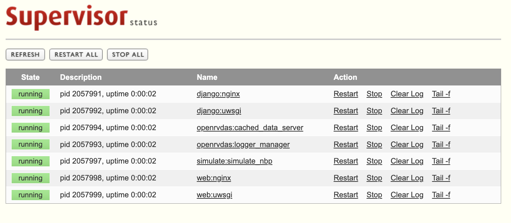

How to get OpenRVDAS onto a machine: the standard installer (which is
what you want), the minimal alternative (for when you truly can't use
the installer), the optional InfluxDB/Grafana stack, securing the
result, and upgrading later.

OpenRVDAS v2.7.0 officially supports:

* **Ubuntu 22.04 and later**, and Linux Mint 22 and later;
* **Debian 12 and later**, including Raspberry Pi OS "bookworm";
* **RHEL, Rocky Linux and AlmaLinux 9 and later**;
* **macOS**.

If run on a distribution newer than the installer has been tested on, the installer will attempt to run, but will issue a warning. Ubuntu- and Debian-based distributions such as Pop!_OS
and LMDE are installed as their base distribution.

All other things being equal, the preferred distribution is Ubuntu 25.10.

**Deprecation**: As of OpenRVDAS v2.7.0, Ubuntu 20.04 and earlier, Debian 11 and earlier (including Raspberry
Pi OS "bullseye"), and CentOS/RHEL/Rocky/Alma 8 and earlier are no
longer supported: none of them packages the Python that v2.7.0 needs
(below), and RHEL 8's SQLite is too old for the Django that comes
with it. New in v2.7.0, the installer checks the operating system
first and refuses an unsupported one by name, before installing
anything. Other Linux distributions are uncharted. For a real
deployment, give OpenRVDAS a dedicated machine or VM; for trying it
out, a personal machine is fine — you'll just answer "no" to the
start-on-boot questions and start things by hand.

**Hardware.** A stripped-down installation running only loggers works
on a machine as small as a Raspberry Pi Zero. The full system needs at
least 4 GB of memory; with InfluxDB and Grafana on the same machine,
at least 2 cores and 8 GB are recommended. Disk is the
resource that grows: raw logfiles are small, but an unpruned database
or the stderr of a logger stuck in a crash loop will fill a partition
eventually. Put the data directory where you can watch it, and give the
database a retention policy (see
[InfluxDB]({{ "/guide/storage-displays/#influxdb" | relative_url }})).

**Python.** OpenRVDAS needs Python 3.11 or newer. The installer
provides it: it uses the system `python3` where that is new enough
(Ubuntu 24.04 and later, Debian 12, RHEL/Rocky/Alma 10), installs
3.11 alongside the system one where it isn't (Ubuntu 22.04,
RHEL/Rocky/Alma 9), and uses Homebrew's Python on macOS. One
interpreter serves both the main virtual environment and the React
console's. Only a [minimal installation](#minimal-installation) leaves
the choice of Python to you.

# Standard Installation

> **Do you actually need a minimal installation instead?** Almost
> certainly not. The standard installer is the supported path: it
> creates the user and virtual environment, installs every dependency,
> and sets up the services, the web console and the simulator for you.
> Install [minimally](#minimal-installation) only if you need OpenRVDAS
> as a library on a machine that will never run the full system.

You will need a user that can run `sudo`. Fetch the installer script
and run it:

```
BRANCH=master
OPENRVDAS_REPO=raw.githubusercontent.com/oceandatatools/openrvdas
curl -O -L https://$OPENRVDAS_REPO/$BRANCH/utils/install_openrvdas.sh
bash install_openrvdas.sh
```

Don't pipe the script straight into bash (`curl ... | bash`): the
installer asks questions on stdin, and piping breaks that. Download
first, then run, as above.

The script will prompt for your sudo password once, then ask a series
of questions, each with a default in parentheses that plain "return"
accepts. What it asks, in rough order:

* **Hostname and install root.** The default root is `/opt`, giving
  you `/opt/openrvdas` — the location the rest of the Guide assumes.
  If you run the script from inside an existing `openrvdas` clone, it
  will detect that and offer to install in place rather than making a
  second copy. Installing under a home directory draws a warning: home
  directory permissions tend to block nginx, and the installer has to
  loosen them to make it work.
* **Repository, branch and proxy.** Defaults are the main repository's
  `master` branch; give your institution's branch if you have one, and
  an HTTP proxy if your ship's network needs one.
* **The OpenRVDAS user.** The services run as a dedicated user,
  `rvdas` by default; the installer creates it if it doesn't exist. On
  macOS it cannot create system users and will offer the current user
  instead.
* **Activate the venv on login?** New in v2.7.0: the installer can add
  the [virtual environment](#the-python-virtual-environment)
  activation line to the OpenRVDAS user's login script, so that
  user's shells always have `listen` and friends on the path.
* **Console password.** Anyone can *view* the web console, but
  loading cruise definitions and changing logger states requires
  logging in. For the Django console this question sets that
  password — deliberately separate from the system password of the
  `rvdas` user.
* **SSL?** Default no. Answering yes leads to providing or creating
  certificate files — see
  [Securing the Installation](#securing-the-installation).
* **Console port.** Port 80 by default (443 with SSL).
* **Firewall?** On CentOS/RHEL/Rocky the installer can configure
  `firewalld`, on Ubuntu `ufw`; both default to no. If you say yes,
  **accept the default UDP ports (6221–6226)** when prompted — those
  are the ports cruise definitions typically broadcast instrument
  data on, and a firewall that doesn't open them silently drops the
  data as it moves between loggers.
* **Start on boot?** Yes for a dedicated machine. If no, the
  supervisor configurations are still written, and
  `supervisorctl start all` / `supervisorctl stop all` control
  everything by hand.
* **Install the simulator?** The test script that replays the NBP
  sample cruise's data (section
  [4. Tutorial]({{ "/guide/nbp-tutorial/" | relative_url }}) depends
  on it). Install it on anything that isn't a production ship
  system; whether it *runs on boot* defaults to no.
* **Which web console: django, react or none?** See the
  [sidebar below](#sidebar-choosing-and-switching-between-the-django-and-react-consoles).
  Choosing `react` adds two follow-ups: whether to expose the FastAPI
  back end's API documentation pages through nginx (default no — they
  publish your API's structure with no authentication), and an
  initial admin username and password for the console.
* **Supervisor web interface?** A small web console for supervisor
  itself on port 9001, from which you can start, stop and restart the
  OpenRVDAS services in a browser; optionally password-protected.
* **Automatic snapshots?** New in v2.7.0: the logger manager can
  record a snapshot of the cruise definition — every file it is built
  from, the code version and the environment — whenever a definition
  is loaded or one of its files changes. About 200 KB each, and worth
  having on any real installation; see
  [Snapshots and the State Journal]({{ "/guide/operations/#snapshots-and-the-state-journal" | relative_url }}).

Your answers are saved to `.install_openrvdas_preferences` in the
install directory and offered as the defaults the next time the
installer runs — which makes re-running it (to add the second console,
or to upgrade) painless.

The installer ends by printing the virtual environment activation
command and wishing you happy logging. To check the result, run
`supervisorctl status` (or browse to port 9001):

```
rvdas@openrvdas:/opt/openrvdas$ supervisorctl status
cached_data_server               RUNNING   pid 2728944, uptime 0:00:35
logger_manager                   RUNNING   pid 2728950, uptime 0:00:35
django:nginx                     RUNNING   pid 3079419, uptime 0:00:35
django:uwsgi                     RUNNING   pid 3079420, uptime 0:00:35
simulate:simulate_nbp            RUNNING   pid 2045646, uptime 0:00:35
```



Then point a browser at the machine and you should see the web
console, ready for section
[2. Working with a Running Installation]({{ "/guide/running-system/" | relative_url }})
— or, better, the tutorial in section
[4]({{ "/guide/nbp-tutorial/" | relative_url }}).

# The Python Virtual Environment

The installer creates a Python virtual environment at
`/opt/openrvdas/venv` (the exact path is printed at the end of
installation) and sets every OpenRVDAS service to run from it. Services
run under supervisor use it automatically; nothing needs activating for
the installed system to work.

To run OpenRVDAS commands by hand, though, activate the virtual
environment in your shell first — otherwise the commands won't be on
your path, and some of the Python packages they depend on won't be
available:

```
source /opt/openrvdas/venv/bin/activate
```

Your prompt gains a `(venv)` prefix, `python` now means the virtual
environment's Python, and the OpenRVDAS commands — `listen`,
`logger_manager`, `lmcmd`, `validate_config` and the rest — can be run
by name. Run them from the OpenRVDAS directory (e.g. `/opt/openrvdas`),
since relative paths in configurations and on the command line are
resolved against the current directory. Run `deactivate` to leave the
virtual environment.

Two conveniences worth knowing:

* For a one-off command you can skip activation by giving the command's
  path in the virtual environment, e.g. `venv/bin/listen ...`.
* The installer offers to add the activation line to the OpenRVDAS
  user's login script, so that user's shells start with the virtual
  environment already active.

# Minimal Installation

A minimal installation is OpenRVDAS as a Python package and nothing
else: no services, no supervisor, no web console, no cached data
server. What you get is the component library and the command-line
tools — enough to build and run individual loggers with `listen`, test
configurations, and develop custom readers, transforms and writers. If
you have one or two "always on" sensors, a minimal installation plus a
cron or systemd entry per logger is a perfectly sound deployment; for
anything more, you'll want the standard installation.

```
git clone https://github.com/OceanDataTools/openrvdas.git
cd openrvdas
python3 -m venv venv
source venv/bin/activate
pip install pyyaml pyserial websockets parse
pip install -e . --no-deps
```

The `python3` here must be 3.11 or newer; `pip install -e .` checks
and refuses an older one. (This is the one path on which the installer
isn't there to find or install a suitable Python for you.) That step
registers `listen`, `simulate_data` and the other OpenRVDAS commands in
the virtual environment, so the command names work here just as on a
standard installation.

Those five packages cover the core components. For the wider set —
database writers, the Modbus reader — run `pip install -e .` *without*
`--no-deps` to pull in the full dependency list; be warned that it
includes `uwsgi` (needs a C compiler and OpenSSL headers) and
`geopandas` (needs GDAL), either of which can fail to build on a
Raspberry Pi or other machine without development tools. Some optional
features install as extras, e.g. `pip install -e '.[geofence]'` for
the `GeofenceTransform`.

There is no migration cost to starting minimal: if you outgrow it, run
the standard installer from inside the clone and it will build the
full system around the code you already have.

# Sidebar: Choosing and Switching Between the Django and React Consoles

OpenRVDAS has two web consoles, and the installer asks which to set up:

| Console | Built with | Status |
|---|---|---|
| `django` | Django, served by nginx + uwsgi | The classic console. Stable and full-featured; the default. |
| `react` | React front end, FastAPI back end, served by nginx + uvicorn | Newer, and still marked experimental by the installer. |
| `none` | | No web console: a headless system controlled from the command line with `lmcmd`. |

If in doubt, take the default. The React console has requirements the
Django console doesn't: **Node.js 22.13.0 or newer** to build its
front end (the installer installs or upgrades Node itself), and the
`web_backend`/`web_frontend` git submodules, which the installer
fetches. Its back end runs in a virtual environment of its own, built
with the same Python the installer chose for the main one.

Only one console runs at a time — both define the same nginx service —
but from v2.7.0 the installer writes the configuration for both on
every run, with the unchosen one disabled. To be able to switch
freely, each console must have been *built* once: run the installer,
choose one; run it again, choose the other.

Thereafter, switching takes one command (new in v2.7.0):

```
cd /opt/openrvdas
bash utils/switch_ui.sh status    # what's configured and running now
bash utils/switch_ui.sh react     # switch to the React console
bash utils/switch_ui.sh django    # switch back
bash utils/switch_ui.sh none      # headless
```

The script shows what it will change and asks before doing it: it
enables the new console's supervisor entry and disables the old one's,
points the logger manager at the matching database (`--database
django` or `--database fastapi`), records the choice in the
installer's preferences, and restarts the affected services.

One consequence matters to operators: **the two consoles don't share a
database.** A cruise definition loaded under one console isn't there
under the other, so after switching, load your cruise definition again
and set the mode you want. Nothing is deleted — the other console's
state is intact if you switch back — but plan for the loggers to stop
briefly during the restart.

# InfluxDB and Grafana

InfluxDB (an open source time-series database) and Grafana (an open
source visualization system) are the recommended way to store and
display parsed OpenRVDAS data: together they give you drag-and-drop
dashboards that far exceed OpenRVDAS's built-in widgets. They are
optional, separate packages — and worth having on almost any real
installation.

> **Note:** older documentation refers to an automated installer,
> `utils/install_influxdb.sh`. It has been deprecated — constant
> version changes in both packages made it impractical to maintain —
> and the supported route is now each package's own installation
> instructions.

The shape of the setup:

1. **Install InfluxDB** following
   [its official instructions](https://docs.influxdata.com/) for your
   platform. Its web interface comes up on port 8086.
2. **Do InfluxDB's initial setup**, creating an organization and a
   bucket (both typically named `openrvdas`) and an admin user, and
   generate an **authentication token** with write access to the
   bucket. Copy the token when it's shown — InfluxDB shows it only
   once.
3. **Give OpenRVDAS the credentials.** Copy
   `database/influxdb/settings.py.dist` to
   `database/influxdb/settings.py` and fill in the URL, organization,
   bucket and token. The `InfluxDBWriter` reads this file, so cruise
   definitions don't need credentials pasted into them (though
   `InfluxDBWriter` also accepts them as keyword arguments if you
   prefer).
4. **Install Grafana** following
   [its official instructions](https://grafana.com/docs/grafana/latest/setup-grafana/installation/);
   it serves on port 3000. Add your InfluxDB as a data source, using
   the same URL, organization and a token.
5. **Build dashboards.** From here it's all Grafana: query the
   `openrvdas` bucket and chart any parsed field. Section
   [7. Storage, Displays and Distribution]({{ "/guide/storage-displays/" | relative_url }})
   covers the OpenRVDAS side — getting data into InfluxDB with the
   `InfluxDBWriter` and the display options beyond it.

# Securing the Installation

OpenRVDAS is built on the assumption that it runs on a ship's
protected internal network, among people who are allowed to see the
data. Its out-of-the-box posture reflects that: the console is served
over plain HTTP, anyone on the network can view it (changing anything
requires login), and loggers broadcast records as cleartext UDP. The
full set of assumptions is spelled out in
[Security Assumptions]({{ "/guide/reference/#security-assumptions" | relative_url }})
— read it before exposing any part of an installation beyond the
ship's network.

What you can tighten at installation time:

* **SSL for the console and websockets.** Answer yes to the
  installer's SSL question and it will serve the console over HTTPS
  and require secure websockets (`wss://`) for off-server access to
  the cached data server (which nginx exposes on the console port at
  the path `/cds-ws`). You'll need a `.key` and `.crt` file; the
  installer will use ones you have or walk you through creating a
  self-signed certificate. Self-signed certificates make browsers
  balk — each user machine needs the certificate imported and
  trusted, and the legacy
  [Secure Websockets]({{ "/secure_websockets/" | relative_url }})
  page walks through that browser-side dance.
* **A firewall.** The installer's firewalld/ufw option closes
  everything but the console port, the supervisor interface, SSH (on
  Ubuntu) and the ports you list — remembering, as above, that the
  UDP data ports (6221–6226 by default) must stay open or the data
  pipeline stops at the firewall.
* **The supervisor web interface password**, if you enable that
  interface: it can start and stop every OpenRVDAS service, so on any
  shared network it should not sit unprotected on port 9001.

# Upgrading an Existing Installation

The supported upgrade path is the installer itself: fetch the current
`install_openrvdas.sh` and run it on the installed system. It detects
the existing clone, reads your previous answers from
`.install_openrvdas_preferences` and offers them as defaults, updates
the code and dependencies, and rewrites the service configurations.
Plan for the system to be down across the run, and don't upgrade a
production system mid-cruise without a reason.

Upgrading to v2.7.0 from an earlier release, expect these changes:

* **Commands have names.** The tools are on the path as `listen`,
  `logger_manager`, `lmcmd` and so on; the old
  `python logger/listener/listen.py` invocations still work (see the
  [conventions table]({{ "/guide/introduction/#conventions" | relative_url }})).
* **Logger stderr moved.** Per-logger stderr now lives under
  `/var/log/openrvdas/loggers/`, rotated; it previously sat directly
  in `/var/log/openrvdas/`.
* **Two consoles.** The installer asks django/react/none, writes
  configuration for both once both are built, and
  `utils/switch_ui.sh` switches between them.
* **New installer questions** for venv-on-login and automatic
  snapshots, which earlier preference files won't have answers for.
* **The consoles display the code version**, so after the upgrade you
  can confirm at a glance what's running.
* **Python 3.11 is required.** A virtual environment built on an
  older Python can't be updated in place: `pip install -e .` will
  refuse. Rerun the installer, which builds a new one with a suitable
  interpreter, installing it first if the system lacks one.
* **Fewer platforms.** Ubuntu 20.04 and earlier, Debian 11 and
  earlier and RHEL/Rocky/Alma 8 and earlier are refused by the
  installer; a machine on one of them needs a newer operating system
  before it can run v2.7.0.

After any upgrade: reload your cruise definition, confirm the mode,
and watch the loggers go green.
