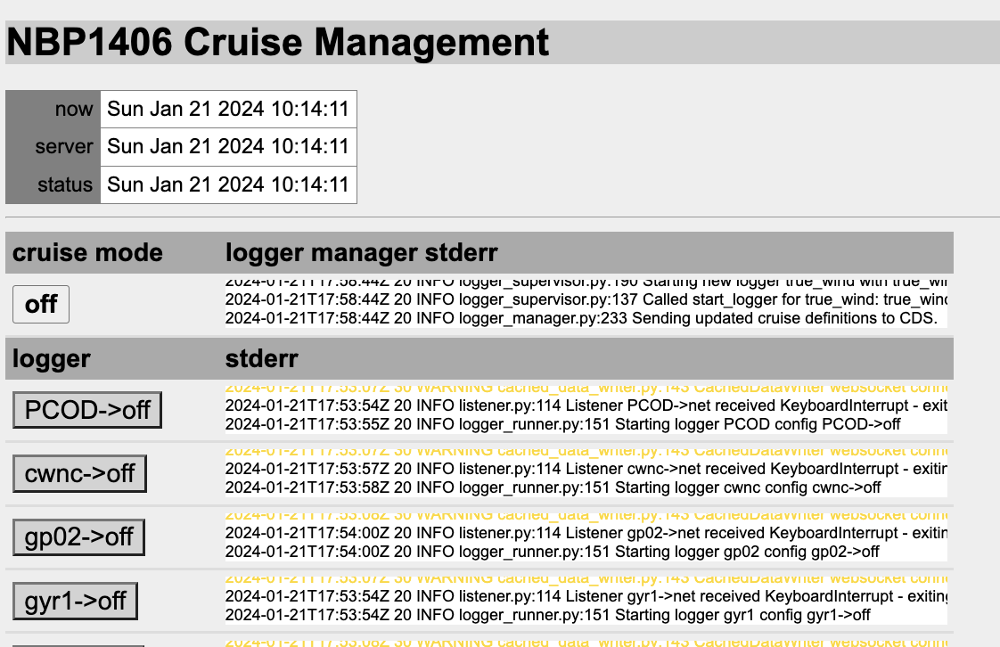

OpenRVDAS ships with a complete sample cruise — real sensor data recorded
aboard the R/V Nathaniel B. Palmer in 2014 — that runs on any
installation with no hardware attached. This tutorial walks it end to
end: simulate the ship's sensors, load the cruise definition, trace a
record through every stage of the system, and poke at the moving parts
with `listen`. Everything later in the Guide refers back to it.

You will need:

* a standard installation (section
  [3. Installation]({{ "/guide/installation/" | relative_url }})), with
  "yes" answered to installing and running the data simulator;
* a browser pointed at the web console, logged in (section
  [2. Working with a Running Installation]({{ "/guide/running-system/" | relative_url }}));
* a terminal on the OpenRVDAS machine, as the OpenRVDAS user, in the
  `/opt/openrvdas` directory, with the
  [virtual environment activated]({{ "/guide/installation/#the-python-virtual-environment" | relative_url }});
* the cruise mode set to `off`, if a cruise definition is already
  loaded in the console. Running loggers hold the simulated serial
  ports, and the first half of this tutorial needs those ports free.

# Simulating Live Data

A data acquisition system without instruments is hard to learn from, so
the installer sets up a simulator. Under supervisor, a program named
`simulate:simulate_nbp` runs

```
simulate_data --config test/NBP1406/simulate_NBP1406.yaml
```

which creates a simulated serial port for each of the Palmer's
instruments — `/tmp/tty_gyr1` for the gyrocompass, `/tmp/tty_s330` for
the Seapath 330 GPS, `/tmp/tty_mwx1` for a weather station, and a dozen
and a half more — and replays each instrument's recorded data through
it at the original pace, looping back to the beginning when it reaches
the end. As far as anything downstream can tell, the ship is underway.

Check that it's running with `supervisorctl status` (or the supervisor
web console on port 9001); if `simulate:simulate_nbp` isn't `RUNNING`,
start it with `supervisorctl start simulate:simulate_nbp`.

Now have a first look at the data. In your terminal, run a minimal
logger — one reader, no transforms, no writers, so the records go to
your screen (this is why the cruise mode must be `off`: a running
`gyr1` logger would be reading the same port, and the two of you
would each get fragments of the stream):

```
listen --serial port=/tmp/tty_gyr1
```

You should see the NBP's gyrocompass reporting its heading, one NMEA
sentence at a time:

```
$HEHDT,218.53,T*12
$HEHDT,218.53,T*12
$HEHDT,218.54,T*11
```

Do you see data? Hurrah. Stop it with Ctrl-C.

The same `simulate_data` command works on your own recorded data — give
it a single feed with `--serial /tmp/tty_mysensor --filebase
path/to/logfiles`, or a YAML file of many feeds with `--config` — which
makes it the test harness for everything you'll build in section
[5. Setting Up Your Own Vessel]({{ "/guide/your-vessel/" | relative_url }}):
develop and debug against replayed data at your desk, then point the
finished configuration at the real ports.

# Loading the Cruise Definition and Starting Loggers

In the console, after logging in, select "Load configuration file" and
load the sample cruise definition:

```
test/NBP1406/NBP1406_cruise.yaml
```

The console will fill with a table of loggers, one per instrument, all
in their `off` configurations:



Everything in that table came from the one file you loaded: the
loggers, the configurations each can run, and the cruise modes that
assign them. The sample cruise defines five modes — `off`, `no_write`,
`write`, and `no_write+influx` / `write+influx` variants that also feed
the InfluxDB database if one is installed.

Select the mode button and change the mode to `no_write`, as described
in [Starting and Stopping Loggers]({{ "/guide/running-system/#starting-and-stopping-loggers" | relative_url }}).
Over the next few seconds, the loggers will pass through yellow to
green: each one will now be reading its simulated instrument and
broadcasting the records on UDP port 6224 — but writing nothing to
disk.

Now change the mode to `write`. The loggers will stay green, and
logfiles will begin to grow. In your terminal:

```
tail -f /var/tmp/log/gyr1/raw/NBP1406_gyr1-$(date -u +%Y-%m-%d)
```

will show the gyrocompass's records being written as they arrive, each
with the timestamp the logger added on receipt.

> **Why `/var/tmp/log`?** The sample cruise deliberately writes
> somewhere disposable — on most Linux systems, files under `/var/tmp`
> that go untouched for 30 days are cleaned up automatically. That is
> exactly right for a demo and exactly wrong for a cruise; when you
> adapt the sample for a real vessel, one of the first things to change
> is `file_root` to a more durable location (see
> [Writing a Cruise Definition]({{ "/guide/your-vessel/#writing-a-cruise-definition" | relative_url }})).

# Following a Record Through the System

With the system in `write` mode, here is the life of a single record —
one heading sentence from the gyrocompass. This is the heart of the
tutorial: every OpenRVDAS installation, however large, is this story
repeated per instrument.

1. **The instrument speaks.** The simulator writes
   `$HEHDT,218.53,T*12` to the simulated serial port `/tmp/tty_gyr1`,
   exactly as the Palmer's gyrocompass did in 2014.

2. **A front-line logger captures it.** The `gyr1` logger is running
   its `net+file` configuration, a four-component pipeline:
   * a `SerialReader` reads the sentence from the port;
   * a `TimestampTransform` prepends the time of receipt:
     `2026-10-28T18:38:55.183000Z $HEHDT,218.53,T*12`;
   * a `LogfileWriter`, mirrored off the timestamp transform, appends
     that timestamped record to
     `/var/tmp/log/gyr1/raw/NBP1406_gyr1-2026-10-28` — the raw record
     is safely on disk before anything else touches it;
   * a `PrefixTransform` prepends the logger's name, and a `UDPWriter`
     broadcasts the result on port 6224:
     `gyr1 2026-10-28T18:38:55.183000Z $HEHDT,218.53,T*12`.

   

   Note what the front-line logger *doesn't* do: no parsing, no
   computation. Timestamp it, store it, pass it on — keeping the
   logger closest to the instrument too simple to fail is deliberate,
   and section 5 returns to it as a design principle.

3. **One second-line logger parses for everyone.** A logger named
   `parse_data` reads everything broadcast on port 6224 with a
   `UDPReader`. Its `ParseTransform` looks up the `gyr1` prefix in the
   sample's device definitions
   (`test/NBP1406/devices/nbp_devices.yaml`), finds that `gyr1` is an
   NMEA MRU whose `HEHDT` sentences carry a true heading, and emits a
   structured record with a named field: `Gyr1HeadingTrue: 218.53`.
   Its `CachedDataWriter` then sends that record to the cached data
   server. In an `+influx` mode, an `InfluxDBWriter` also writes the record to the InfluxDB database.

4. **Subscribers take it from there.** The cached data server hands
   the new value to whoever has subscribed to it: the console's
   display widgets; the `true_winds` loggers, which combine heading
   with GPS course, speed and relative wind from two other instruments
   to compute true wind and write it back to the server as new fields;
   and anything else you point at it.

You can eavesdrop on every hop of that journey yourself, each with a
one-line `listen` command or less:

* the serial port: `listen --serial port=/tmp/tty_gyr1` — but set
  `gyr1` to `off` in the console first: a serial port has only one
  stream to give, and with the `gyr1` logger running, the two of you
  would each get fragments of it
* the UDP broadcast — every instrument's records interleaved:
  `listen --udp 6224 --write_file -`. Only one process can bind the
  port, and in any active mode the `parse_data` logger already has
  it, so set `parse_data` to `off` in the console first (and back
  afterwards)
* the parsed values, by name, from the cached data server — nothing
  needs stopping, since the server is built for many subscribers:
  `listen --cached_data Gyr1HeadingTrue --write_file -`
* the file on disk: `tail -f /var/tmp/log/gyr1/raw/NBP1406_gyr1-<date>`
* the parsed values, as a display: with the system in a parsing mode,
  open `http://openrvdas/display/nbp_dashboard.html` and watch the
  heading dial track the data.

# Exploring with listen

The `listen` command you've been using is OpenRVDAS's jack-of-all-trades:
it assembles a logger from command-line flags or a configuration file
and runs it in the foreground. Two more ways to use it complete the
tutorial.

**Build a pipeline by hand.** The `gyr1` logger's `net` configuration,
reconstructed flag by flag:

```
listen \
    --serial port=/tmp/tty_gyr1 \
    --transform_timestamp \
    --transform_prefix gyr1 \
    --write_file - \
    --write_udp 6224
```

Each flag adds a component; `--write_file -` means "and show it on
stdout". (One gotcha worth knowing early: flag order matters —
readers, then transforms, then writers, in the order you want them
applied. Section
[5. Setting Up Your Own Vessel]({{ "/guide/your-vessel/#creating-and-testing-loggers" | relative_url }})
covers `listen` in earnest.)

**Run a configuration straight from the cruise definition.** Any
logger configuration in a cruise definition file can be run by itself,
by naming it after a colon:

```
listen test/NBP1406/NBP1406_cruise.yaml:gyr1-net
```

First set `gyr1` to `off` in the console — two loggers can't share one
serial port — then run the command above. You will then be running
exactly what the logger manager runs, but in the foreground of your own
terminal, with its errors in your face. That, in one sentence, is the
debugging method of section
[9. Troubleshooting]({{ "/guide/troubleshooting/" | relative_url }}):
take the piece that's misbehaving, run it by itself with `listen`, and
look at what it says. Make the habit now and the red buttons will never
scare you.

When you're done exploring, set the system back to the mode you found
it in — and if this machine is anyone's real installation, remember
that `write` mode is filling `/var/tmp/log`.
