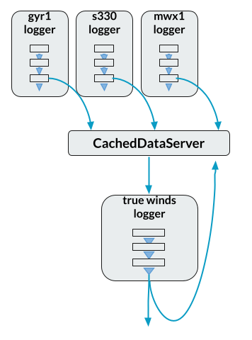

Raw sensor output is rarely the number science wants. The TSG reports
counts that need a calibration applied; true wind has to be computed
from five readings spread across three instruments; the summary file
wants one-minute averages, not 10 Hz jitter. This section covers the
machinery for all of it:

* **Computed fields** — algebraic equations in the cruise definition,
  evaluated on the data as it flows (new in v2.7.0);
* **Calibrations** — the discipline for managing the coefficients
  those equations use: where they come from, where they live, and how
  to prove which ones were in effect when;
* **Averaging and resampling** — turning irregular readings into
  regular statistics;
* **Derived data loggers** — the architectural pattern underneath the
  other three: loggers that subscribe to the cached data server,
  compute, and publish the results back.

# Computed Fields

`ComputedFieldsTransform` computes new fields from algebraic
expressions over the fields passing through it — anything from a
one-line linear calibration to true winds — without writing any
Python. The arithmetic lives in the cruise definition, where it can be
read, reviewed and version-controlled.

Suppose the TSG reports `SeawaterTemp`, and its calibration sheet says
the true temperature is `1.00021 × reading − 0.0032`:

```
- class: ComputedFieldsTransform
  kwargs:
    fields:
      SeawaterTempCal:
        equation: "slope * SeawaterTemp + offset"
        constants:
          slope: 1.00021
          offset: -0.0032
```

Each entry under `fields` is a **rule**, named for the field it
produces. Bare names in its `equation` refer to the record's fields or
the rule's `constants`. Records that lack a rule's inputs pass through
unchanged — on a mixed stream, most records won't have the fields a
given rule needs, and that's normal.

**Equations** are Python-style expressions: arithmetic, comparisons
and logic, conditional expressions (`x if cond else y`), and a fixed
menu of math functions (`abs`, `round`, `sqrt`, the trig family in
radians, `atan2`, `hypot`, `degrees`/`radians`, `log`, and friends,
plus `pi` and `e`). Anything else — attribute access, indexing,
lambdas, unbounded exponents — is refused, and refused *early*:
equations are checked when the logger starts, and by `validate_config`
before that, so a typo stops the logger with a clear error rather than
corrupting data at 3 a.m. An equation that fails on a particular
record (a divide by zero, say) simply produces no value for that
record, with a warning logged once rather than at 10 Hz.

Beyond the basics, the features that carry real configurations:

* **A `null` constant disables its rule.** This is the intended way to
  say "we have no calibration for this sensor yet": the transform
  logs that it isn't computing the field, and everything else carries
  on. It is load-bearing for calibration files, below.
* **`inputs` aliases** let a textbook formula read like the textbook:

  ```
  SoundVelocity:
    equation: "1449.2 + 4.6*T - 0.055*T**2 + 1.39*(S - 35) + 0.016*D"
    inputs: {T: SeawaterTemp, S: Salinity, D: Depth}
  ```

* **Rules run in order, and later rules can use earlier results.**
  Mark a rule `intermediate: true` to feed later rules without
  appearing in the output. A rule that produces nothing also silences
  every rule built on it — which makes a one-line validity gate:

  ```
  fields:
    valid:
      equation: "True if 0 <= Heading <= 360 else None"
      intermediate: true
    HeadingCorrected:
      equation: "(Heading + offset) % 360 if valid else None"
      constants: {offset: -0.8}
  ```

* **`delete_input_fields` and `delete_other_fields`** control what
  else survives. The combination that matters most: both `true`, for
  a logger that reads raw fields from the cached data server and must
  write back *only* its computed results.
* **Inputs from different instruments** arrive in different records.
  `update_on_fields: [...]` says which field's arrival triggers a
  computation, `max_field_age: {Field: seconds}` refuses stale
  remembered values, and either implies `cache_inputs: true`, which
  remembers the latest value of each input across records. These
  three mean the same here as they do for `TrueWindsTransform`.
* **`warn_missing_inputs: true`** answers "why isn't my field
  appearing?" while you're setting things up.

For the common one-field case,
`contrib/logger_templates/computed_fields_logger_template.yaml` wraps
the cached-data-server reader and writers around a single rule, so a
calibration logger is a few lines in the `loggers` section.

The showpiece is **true winds written as rules**: a validity gate, an
apparent-wind rule, intermediate vector components, and the speed and
direction — every step visible and changeable in the configuration,
with the anemometer's zero line drawn from a calibration file. The
complete, tested configuration is in the repository at
`test/configs/computed_true_winds.yaml` (runnable against the NBP
sample cruise with
`listen test/configs/computed_true_winds.yaml`), and
walked through line by line, with the full option tables, on the
[Computed Fields]({{ "/computed_fields/" | relative_url }}) page. If
you just want true winds and the dedicated `TrueWindsTransform` suits
you, use it — see
[Derived Data Loggers](#derived-data-loggers) below.

When the built-in function list is too small — TEOS-10 seawater
routines, say — subclass the transform in your own module and widen
its `FUNCTIONS` table, then load it with a `module:` key from your
[institution's repository]({{ "/guide/your-vessel/#your-institutions-repository-and-local" | relative_url }}).

# Calibrations

Calibration coefficients change more often than the processing that
uses them, and they need a clear history: which coefficients were in
use on which dates. The discipline that provides it:

* each set of coefficients lives in its own **dated file**, under
  source control in your institution's repository;
* a fixed name, `calibrations.yaml`, points at the current one with a
  **symbolic link** (a relative link, so it survives the repository
  being checked out elsewhere);
* the cruise definition **includes** `calibrations.yaml` and uses the
  coefficients as **variables**.

```
local/uuw/mvp/
  calibrations-2026-04-15.yaml        previous coefficients, kept for the record
  calibrations-2026-10-01.yaml        current coefficients
  calibrations.yaml -> calibrations-2026-10-01.yaml
```

The dated file is just variables, with a comment trail saying where
each number came from:

```
# calibrations-2026-10-01.yaml
# Coefficients from the October 2026 shipyard calibrations.

variables:
  # SBE45 TSG temperature, s/n 4521, calibrated 2026-09-12
  tsg_temp_slope: 1.00021
  tsg_temp_offset: -0.0032

  # Biospherical PAR sensor: not yet calibrated after replacement
  par_scale: null
```

and the cruise definition uses them as constants:

```
includes:
  - local/uuw/mvp/calibrations.yaml
...
      SeawaterTempCal:
        equation: "slope * SeawaterTemp + offset"
        constants:
          slope: <<tsg_temp_slope>>
          offset: <<tsg_temp_offset>>
```

`par_scale: null` disables the PAR rule, and nothing else — better an
absent field than a confidently wrong one.

**Don't give calibration variables defaults.** `<<tsg_temp_slope|1.0>>`
would silently publish uncalibrated readings under a name that claims
they're calibrated whenever the variable is misspelled or missing.
Written without a default, that same mistake is *caught*:
`validate_config` reports the unexpanded `<<tsg_temp_slope>>` as an
error, and the logger manager logs it at load time. Every coefficient
belongs in the calibration file, with `null` standing in for "not
calibrated yet".

**Updating a calibration** never touches the cruise definition:

1. copy the current dated file to a new date, update the values and
   their provenance comments, commit;
2. move the link (`ln -sfn calibrations-2026-11-15.yaml
   calibrations.yaml`) and commit that too, so the repository records
   which file was current when;
3. run `validate_config` on the cruise definition;
4. reload the definition in the console — running loggers keep their
   old coefficients until you do, and the logger manager then
   restarts only the loggers whose configurations changed.

If automatic
[snapshots]({{ "/guide/operations/#snapshots-and-the-state-journal" | relative_url }})
are on, one is taken when the link moves and another at the reload,
and a snapshot's manifest records which dated file the link resolved
to — so "which coefficients were applied to the TSG in October?" has
a checkable answer.

(Before v2.7.0, linear calibrations ran through
`ModifyValueTransform` and `calibration_logger_template`; both still
work, but `ComputedFieldsTransform` is the general choice for
anything new.)

# Averaging and Resampling

Instruments report at their own rates — the GPS at 1 Hz, the met
station every 2 seconds, the TSG every 5, none on the same second.
`InterpolationTransform` turns those irregular readings into values
at regular times: an average, median or other statistic of each field
over a window centred on each output time. The usual reasons: a
one-minute cruise summary, several instruments resampled onto a
common time base, QC statistics, or smoothing for display.

The quickest route is `averaging_logger_template`:

```
includes:
  - contrib/logger_templates/averaging_logger_template.yaml

loggers:
  met_avg:
    logger_template: averaging_logger_template
    variables:
      # Every field to read; must repeat all fields listed below
      snapshot_fields: [AirTemp, BaroPressure, WindSpeed, WindDir]

      # Fields to be averaged arithmetically (boxcar average); omit if none
      average_fields: [AirTemp, BaroPressure, WindSpeed]

      # Fields to be averaged as angles (polar average); omit if none
      direction_fields: [WindDir]

      interval: 60      # seconds between outputs
      window: 60        # seconds of data in each average
```

This logger will read `AirTemp`, `BaroPressure`, `WindSpeed` and  `WindDir` from the cached data server, and every 60 seconds will write `AvgAirTemp`, `AvgBaroPressure`,
`AvgWindSpeed` and `AvgWindDir` back to it. Each
output keeps its source's name with `Avg` prefixed. The template's
`on+influx` config also writes the averages to InfluxDB.

`snapshot_fields` is the logger's subscription to the cached data
server, which is why it has to repeat the other two lists: the
template machinery can't join two lists itself. A field listed only
in `snapshot_fields` is read but produces no output.

Directions get their own list because compass angles can't be
averaged arithmetically: readings of 359° and 1° would average to
180°, the opposite of the truth, where the polar average gives 0°.
Wind and current directions and headings belong in
`direction_fields`.

Three properties of the output are worth having straight before you
wire a display to it:

* **Outputs lag real time by half the window** (plus up to one input
  interval): a 60-second average centred on 12:00:00 can't exist
  until the data after 12:00:30 has arrived.
* **Output times aren't aligned to the clock** — they start at the
  first record's timestamp and step by `interval` from there — and
  each output is stamped with its *centre* time, not the time it was
  produced.
* **The first output's window is only half full.** The `min_count`
  option suppresses outputs computed from too few readings, if that
  matters.

Beyond `boxcar_average` and `polar_average`, v2.7.0 added `median`,
`trimmed_mean`, `time_weighted_average`, `gaussian_average`,
`triangular_average` and `exponential_average`, window statistics
(counts, spreads) to publish alongside the averages, and the
`min_count`, `outlier_mads` and `trim` options for keeping bad
readings out of the statistics. The algorithm-by-algorithm reference
and recipes are on the
[Averaging and Resampling]({{ "/interpolation_transform/" | relative_url }})
page.

# Derived Data Loggers

Everything above has quietly used the same architecture, worth
stating plainly, because it's the answer to a question every
installation hits: *how do you compute with values from different
instruments, arriving asynchronously on different schedules?*

The answer is the cached data server as rendezvous. A **derived data
logger** is an ordinary logger whose reader is a `CachedDataReader`
subscribed to the fields it needs, whose transforms compute something
from them, and whose writer is a `CachedDataWriter` publishing the
results back:



The front-line loggers for the gyro, GPS and anemometer never know
the true winds logger exists, and the true winds logger never knows which serial ports its
inputs came from. New values appear to its subscription as they're
parsed; its outputs are instantly available to the displays, the
database writers, and any further derived-data logger that wants to
build on them.

The classic inhabitant of this pattern is the dedicated
`TrueWindsTransform`:

```
true_winds_port->on:
  readers:
    class: CachedDataReader
    kwargs:
      data_server: localhost:8766
      subscription:
        fields:
          S330CourseTrue: {seconds: 0}
          S330HeadingTrue: {seconds: 0}
          S330SpeedKt: {seconds: 0}
          MwxPortRelWindDir: {seconds: 0}
          MwxPortRelWindSpeed: {seconds: 0}
  transforms:
  - class: TrueWindsTransform
    kwargs:
      course_field: S330CourseTrue
      heading_field: S330HeadingTrue
      speed_field: S330SpeedKt
      wind_dir_field: MwxPortRelWindDir
      wind_speed_field: MwxPortRelWindSpeed
      convert_speed_factor: 0.5144        # ship speed from kt to m/s
      update_on_fields: [MwxPortRelWindDir]
      apparent_dir_name: PortApparentWindDir
      true_dir_name: PortTrueWindDir
      true_speed_name: PortTrueWindSpeed
  writers:
  - class: CachedDataWriter
    kwargs:
      data_server: localhost:8766
```

It caches the latest value of each input and emits a new true wind
each time the anemometer reports (`update_on_fields`) — the same
semantics `ComputedFieldsTransform` borrows for its own
multi-instrument rules. The NBP sample cruise runs a pair of these,
port and starboard, which is what puts `PortTrueWindDir` on the
tutorial's displays.

Which to use where? A **dedicated transform** (`TrueWindsTransform`
and its kin) packages a known calculation behind a few field-name
parameters: least configuration, least visibility. A
**`ComputedFieldsTransform`** rule chain makes every step visible and
changeable in the definition. An **`InterpolationTransform`** logger
is the same pattern again with time-window statistics as the
computation. They compose, too: the sample cruise's snapshot logger
subscribes to the true winds loggers' *outputs* and publishes
ten-second averages of them — derived data derived from derived data,
with the cached data server as the only coupling between any of it.
