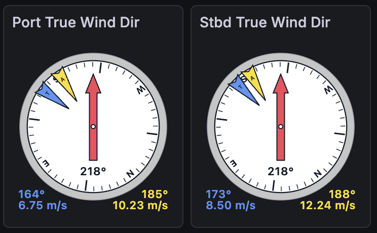

This section discusses where the data goes once a logger has it, including:
* the cached data server that
feeds everything live
* any external databases that keep history
* the displays people actually look at
* mirroring it all ashore, and
* spreading the load across machines when one stops being enough.

# The Cached Data Server

The cached data server (CDS) is the live hub of a running
installation: an in-memory cache of the recent values of every named
field, served to subscribers over websockets. The standard
installation runs one under supervisor on port **8766**, with a disk
cache that re-warms the memory cache across restarts and retention
limits (`--back_seconds`, `--max_records`) that keep it from growing
without bound. It is deliberately not long-term or archival storage — the logfiles and
any external database are the records — but everything *live* flows through it:
console status, display widgets, derived-data loggers, and your own
subscribers.

Data gets in through a logger's `CachedDataWriter`, which forwards
each record as a websocket `publish` message (and buffers locally if
the connection drops). Data gets out through subscriptions, and one
piece of subscription vocabulary pays for itself everywhere, because
`CachedDataReader`, the display widgets and `listen --cached_data`
all share it — the per-field `seconds` value:

| `seconds` | First response contains |
|---|---|
| `0` | nothing — only values that arrive after subscribing |
| `-1` | the single most recent value, then new values as they arrive |
| `N` | up to N seconds of history, then new values as they arrive |

Subscriptions can also name fields with `*` wildcards, guarantee a
minimum number of historical records (`back_records`), slow the push
rate for low-bandwidth clients (`interval`), and ask for output
collated by timestamp (`format: record_list`) instead of the default
per-field lists.

For one-off queries — a shell script, an elog entry, anything that
doesn't want a websocket — the server also answers plain HTTP GET on
the same port:

```
# List every field the server currently has
curl http://localhost:8766/fields

# Get the latest value and timestamp of particular fields
curl http://localhost:8766/latest/S330CourseTrue,S330SpeedKt
```

Keep HTTP for occasional queries: the requests share the event loop
with every websocket client, so polling it hard delays data delivery
to everyone else. Anything continuous belongs on a subscription —
via `listen --cached_data` at the terminal, a `CachedDataReader` in a
logger, the `websockets` library from external Python, or a raw
browser `WebSocket`. The
[Cached Data Server]({{ "/cached_data_server/" | relative_url }})
page documents the full protocol, every client pattern, and the
server's flags.

# External Databases

OpenRVDAS has no database of its own. The cached data server holds
only recent values, and the logfiles hold raw records, so for history
you can query — a week of heading, a cruise's worth of sea surface
temperature — loggers write their parsed fields to an external
database. Which database is your choice. To OpenRVDAS it is just
another destination, reached through a writer.

The writers available:

* **`InfluxDBWriter`**, for InfluxDB, a time-series database. This is
  the most common choice, and the one the rest of this section uses as
  its example.
* **`DatabaseWriter`**, a generic writer with connectors for MySQL, MariaDB,
  PostgreSQL and MongoDB. Each connector has a setup script under
  `database/`.
* **`RedisWriter`**, for publishing to Redis.
* **Contributed writers** in the
  [openrvdas_contrib](https://github.com/OceanDataTools/openrvdas_contrib)
  repository, such as a TimescaleDB writer.
* **Your own.** A writer is any class with a `write(record)` method
  (see
  [Creating and Testing Loggers]({{ "/guide/your-vessel/#creating-and-testing-loggers" | relative_url }})),
  so if your institution already runs a database, a writer for it is a
  short piece of code.

Whichever you use, the pattern is the same: the database writer sits
in a parsing logger next to its `CachedDataWriter`, so each parsed
record goes both to the live hub and into history.

## InfluxDB

Most OpenRVDAS installations use InfluxDB, mostly because it pairs
well with Grafana for displays. Each parsed field is stored as a time
series, and InfluxDB's query language, Flux, can select, aggregate
and transform them. Installation and credentials are covered in
[section 3]({{ "/guide/installation/#influxdb-and-grafana" | relative_url }}).
Once `database/influxdb/settings.py` is filled in, feeding the
database takes one writer:

```
writers:
- class: CachedDataWriter
  kwargs:
    data_server: localhost:8766
- class: InfluxDBWriter
  kwargs:
    bucket_name: openrvdas
    measurement_name: gyr1
```

`measurement_name` groups fields under the instrument they came from,
which keeps the database browsable. The sample cruise's `+influx`
modes do exactly this.

Three working tips. First, **generate Flux queries instead of writing
them**: build the query in InfluxDB's Data Explorer (pick fields, set
aggregation and range, Submit), then open its Script Editor and paste
the resulting Flux into a Grafana panel. Second, **InfluxDB tasks can
compute**: a task is a Flux query run on a schedule, writing its
results to another bucket. Tasks are the mechanism behind both the
[feed-status monitoring]({{ "/guide/troubleshooting/#monitoring-feed-health" | relative_url }})
dashboard and the
[shoreside replication](#shoreside-replication) below. Third, **give
the bucket a retention policy**. By default InfluxDB keeps everything
forever, and on a ship that means the database, not the raw logfiles,
is what eventually fills the disk. A bucket's settings (in the web
console, under Load Data, then Buckets) set how long it keeps data;
the raw logfiles remain the permanent record, so the database only
needs to hold as much history as the displays use.

# Displays

**Grafana dashboards** are the recommended display route: open
source, drag-and-drop, maintained by a large community that isn't us.
Grafana reads from most common databases, InfluxDB included. Once it
has a data source for yours (for InfluxDB, see section
[3]({{ "/guide/installation/#influxdb-and-grafana" | relative_url }})),
a dashboard is a set of panels, each backed by a query — time series,
gauges, stats, maps. Like OpenRVDAS, Grafana takes plugins,
and purpose-built marine panels exist: the
[OpenRVDAS compass panel](https://github.com/OceanDataTools/grafana-compass-panel)
draws an integrated wind/compass rose from heading and wind fields:



**Grafana Live** covers the case a database can't: sub-second,
lag-free display. The `GrafanaLiveWriter` posts records straight to
Grafana's live-streaming endpoint — no database in the path, 20 Hz
and up — for the helm display or winch readout where a
store-then-query round trip is too slow. Streamed data isn't
retained, so loggers that feed Grafana Live usually also write to a
database for the record. Setup is on the
[Grafana Live]({{ "/grafana_live/" | relative_url }}) page.

**The built-in display widgets** predate all of this: Highcharts- and
D3-based dial, timeline, text and map widgets on web pages served by
the console under `/display/`, fed by direct websocket subscription
to the CDS — the tutorial's `nbp_dashboard.html` is one. They still
work, many vessels still run them, and the raw browser-websocket
route they use remains supported; but the widget framework itself is
deprecated, and new display work belongs in Grafana. Their
construction is documented on the legacy
[Displays and Widgets]({{ "/display_widgets/" | relative_url }})
page.

# Shoreside Replication

The goal: the same Grafana dashboards ashore that the ship uses at
sea, fed over a satellite link that comes and goes — with control
over which sensors shore is allowed to see. Most databases have some
form of replication. The recipe here is for InfluxDB, and its pieces
are all standard InfluxDB machinery driven by OpenRVDAS modes:

1. **Tag at write time.** The parsing logger's `InfluxDBWriter` tags
   every measurement `restricted: 'no'` — except in a
   `+influx_restricted` variant of the config, which tags the
   sensitive instruments' measurements `restricted: 'yes'`. Which
   variant runs is just a cruise mode, so *restricting a sensor is a
   mode change in the console*, logged in the journal like any other.
2. **Filter and thin with a task.** An InfluxDB task runs every
   second, selects where `restricted == 'no'`, averages the numeric
   fields over the second, and writes the result to a
   `non_restricted` bucket with a short retention — a smaller,
   cleaner stream sized for the link.
3. **Replicate the bucket.** InfluxDB's native replication streams
   the `non_restricted` bucket to the shore server, queueing across
   outages and catching up when the link returns. Shore lags the
   ship; it never breaks.
4. **Point shore Grafana at the replica.** The dashboards are the
   same ones used aboard.

The complete worked configuration — modes, logger configs, the Flux
task and the replication commands — is in the
[InfluxDB Ship-to-Shore Replication]({{ "/cookbook/influxdb_shoreside_replication/" | relative_url }})
cookbook. (And the standing rule it opens with: replicate
non-restricted data only.)

# Distribution and Load Balancing

One machine runs most installations comfortably. The reason to use
more than one isn't usually capacity — it's isolation. Logging is the
part whose failure loses data forever; databases and displays can
crash and catch up. So the aim of splitting an installation across
machines is to keep everything else from interfering with the
loggers.

**Two machines: isolate the database and displays.** The first and
most valuable split moves the database and displays off the machine
doing the logging:


The logging machine runs all of OpenRVDAS: the front-line loggers
(read, timestamp, write raw to disk, broadcast) and the loggers that
parse and compute derived values. The second machine runs the
database and Grafana. The parsing loggers reach it simply by pointing
their database writer at the second machine's address instead of
`localhost`.

This guards against the two most common ways a busy installation
hurts its own logging. A database that grows until it fills its disk
fills the database machine's disk, not the one the raw logfiles are
being written to. And a heavy display load — a room full of
scientists browsing dashboards, a runaway query, a Grafana upgrade
gone wrong — competes for the second machine's CPU and memory, not
the loggers'.

**Three machines: isolate the front-line loggers too.** For truly
robust operation, also separate the front-line loggers from
everything downstream of them — parsing, derived data and the rest:


The first machine now does nothing but read the instruments, write
the raw records to disk and broadcast them. A second runs the
parsing and derived-data loggers, and a third the database and
displays. A malformed record that crashes the parser, a
derived-data logger that spins out of control, or a configuration
change to the computations then can't touch the machine holding the
serial ports. That machine is so simple that there's little left to
go wrong with it.

The relay from the front-line machine to the parsing machine uses
the same mechanisms the loggers already use, reaching across
machines instead of across processes:

* **UDP broadcast** is the lightweight default: the front-line
  loggers' `UDPWriter`s already broadcast to the subnet, and the
  parsing machine's `parse_data` logger just runs its `UDPReader`
  there instead. If a firewall sits between them, the data ports
  (6221–6226 by convention) must be open, per
  [section 3]({{ "/guide/installation/#standard-installation" | relative_url }}).
* **The cached data server** is the alternative when you want
  delivery guarantees or to cross subnets: writers point their
  `data_server` at `host:port` rather than `localhost`, and
  `CachedDataWriter` buffers through interruptions.

In either arrangement, where the pieces land is pure configuration: the cruise definition's
variables name the UDP destination, data server and database URL, so
moving a tier to another machine is a variables change, not a
redesign. The shoreside replica above is the same idea stretched over
a satellite link — and a second OpenRVDAS installation elsewhere on
the ship can always subscribe to the first one's CDS, which is how
systems like CORIOLIX build on OpenRVDAS without touching its
loggers.
