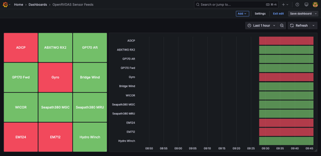

When something breaks, this section is in rough order of usefulness:

* where the evidence is;
* the failures almost every installation runs into sooner or later,
  with their symptoms and fixes;
* how to narrow a problem down to one stage of one logger;
* how to find out about trouble before the science party does.

If you're a watchstander facing a red button right now, start with
[When Something Goes Red]({{ "/guide/running-system/#when-something-goes-red" | relative_url }})
in section 2. This section picks up where that leaves off, and assumes
you have a terminal on the OpenRVDAS machine with the
[virtual environment activated]({{ "/guide/installation/#the-python-virtual-environment" | relative_url }}).

# Where to Look

OpenRVDAS writes down most of what goes wrong. The trick is knowing
which of several places to look in.

**A logger's own error output.** Each logger's stderr is the first
place to look for a logger that is red, yellow or silent. You can
see the last few lines in the console, by selecting the logger's
button. The whole thing is on disk:

```
/var/log/openrvdas/loggers/<logger>.stderr
```

Each file is rotated when it reaches 1 MB, with up to 100 old files
kept beside it as `<logger>.stderr.1`, `.2` and so on. This matters
for a logger that has been crashing and restarting in a loop: the
first, most informative error may already be in a rotated file, not
the current one. (Before v2.7.0, the files were one level up, in
`/var/log/openrvdas/` itself.)

**The servers' error output.** The logger manager and the cached data
server write to `/var/log/openrvdas/logger_manager.stderr` and
`/var/log/openrvdas/cached_data_server.stderr`. The logger manager's
is where to look when a cruise definition won't load, or when loggers
won't start at all. The console's mode dialog shows its last few
lines too.

**The state journal.** The journal, described in
[section 8]({{ "/guide/operations/#snapshots-and-the-state-journal" | relative_url }}),
records every mode change and every logger start, stop, crash and
recovery, with times. It answers "when did this start?" and "what
changed just before?" For example, every crash or failure of any
logger today:

```
jq -c 'select(.message_type | test("crashed|failed|recovered")) | .fields' \
   /var/log/openrvdas/logger_manager_journal-$(date -u +%F)
```

**Supervisor.** The logger manager, the cached data server, the
console and the simulator all run under supervisor. `supervisorctl
status` shows whether each is running, and `supervisorctl tail -f
logger_manager stderr` follows a server's output live. The supervisor
web page on port 9001 shows the same. If the logger manager itself
isn't running, nothing else matters until it is.

**The cached data server.** If the console shows loggers running but
displays are blank, ask the cached data server what it actually has:

```
# List every field the server currently has
curl http://localhost:8766/fields

# Watch new values of particular fields as they arrive
# (if nothing appears, they aren't arriving)
listen --cached_data SeapLatitude,Gyr1HeadingTrue
```

**A snapshot.** When you suspect that what's running isn't what's in
the files, take a snapshot. Its manifest says, for each logger,
whether its running configuration matches the definition on disk
(see [Taking a snapshot]({{ "/guide/operations/#taking-a-snapshot" | relative_url }})).

# Common Failure Modes

Each entry below gives the symptom, the usual cause, and the fix.

**`listen: command not found`**, or any OpenRVDAS command. The
virtual environment isn't active in this shell. Run
`source /opt/openrvdas/venv/bin/activate`, from the OpenRVDAS
directory. See
[The Python Virtual Environment]({{ "/guide/installation/#the-python-virtual-environment" | relative_url }}).

**A logger goes red the moment it starts, and its stderr says
`Permission denied` opening a serial port.** The OpenRVDAS user can't
read the device. On Linux, serial devices usually belong to the
`dialout` group. The installer adds the OpenRVDAS user to that group
on Ubuntu, but not on CentOS, RHEL or Rocky. Check with
`ls -l /dev/ttyUSB0` (or whichever port), then add the user to the
device's group:

```
sudo usermod -a -G dialout rvdas
```

Group changes apply to new processes only, so restart the logger
manager (`supervisorctl restart logger_manager`) and the loggers it
starts will have the new permission.

**A logger goes red, and its stderr says `No such file or
directory` for its serial port.** The device isn't there. A USB
serial adapter may have been unplugged, or may have come back with a
different name after a reboot (`/dev/ttyUSB1` instead of
`/dev/ttyUSB0`). `ls /dev/tty*` shows what exists now. For the
sample cruise, this error means the simulator isn't running: start
it with `supervisorctl start simulate:simulate_nbp`.

**A logger is green, but its parsed fields never appear.** The
records are flowing but the parser isn't matching them. Three usual
causes, in order of likelihood:

* The record's prefix doesn't match a device name in the
  definitions. The parser uses the first word of each record, added
  by the `PrefixTransform`, to find the device. `gyr1` and `Gyr1`
  are different devices.
* The parser isn't reading your definition file. Giving
  `definition_path` *replaces* the default, so it must name every
  file you need, including the bundled NMEA library.
* The format doesn't match the record, often because a field is
  sometimes empty and the format uses `f` where it needs `of`.

Test a format against a real record with `check_parse_format`, then
run the parsing logger with `listen -v -v` to see each record it
rejects. Both are described in
[Parsing and Device Types]({{ "/guide/your-vessel/#parsing-and-device-types" | relative_url }}).

**A cruise definition won't load, with `Unexpanded variables
found: <<...>>`.** A variable in the definition is misspelled, or
isn't defined anywhere. The message names it. Calibration variables
are the usual case; see
[Calibrations]({{ "/guide/computed-values/#calibrations" | relative_url }}).
Run `validate_config` on the definition: it reports this and most
other definition problems before you try to load it.

**A cruise definition has a mode named `False`**, or `off` mode is
missing. In YAML, an unquoted `off` means false. Mode names, and
config names (like `gyr1-off`), must be quoted if they exactly match a YAML keyword, such as
`off`, `on`, `yes` or `no`. Use the quoted form, `'off':`, instead. See the
[YAML primer]({{ "/guide/reference/#yaml-syntax" | relative_url }}).

**Every logger turns red at once, and the status times at the top of
the console stop updating.** The console has lost contact with the
cached data server, not the loggers. The loggers are probably
still running and still writing to disk. Check `supervisorctl status
cached_data_server`, and restart it if it isn't running. Then reload
the console page.

**The console loads but never comes alive, and only on some
networks.** The console works from the OpenRVDAS machine, or over the
ship's wired network. But from a laptop on a particular wifi network,
the page appears and nothing on it updates: no logger states, no
status times. The cause is the network, not OpenRVDAS. Some wifi
networks, often guest or institutional ones, pass web traffic through
an HTTP proxy, usually as part of the router's firewall or content
filter. The console page itself is ordinary web traffic, so it gets
through. Its live updates come from the cached data server over a
websocket, which starts as a web request with an `Upgrade` header
asking to switch protocols. Some proxies strip that header. The
request then reaches the cached data server as a plain web request,
and the server refuses it. Opening port 8766 won't help: the console
reaches the cached data server through the console's own port, at the
path `/cds-ws`.

You can confirm it in two places. In the browser's developer console,
`Trying to connect to websocket at ...` repeats every three seconds,
and if the proxy identifies itself, a warning starting `WebSocket
connection appears to be blocked by an HTTP proxy` follows. On the
server, `/var/log/openrvdas/cached_data_server.stderr` will have a
matching warning:

```
WARNING cached_data_server.py:1050 WebSocket upgrade on port 8766 was blocked
by an HTTP proxy (Via: 1.1 squid) which stripped the Upgrade header. ...
```

Both warnings depend on the proxy announcing itself with a `Via`
header, which most proxies do but not all. To test the path directly,
ask for a websocket by hand from the affected laptop:

```
curl -i --max-time 2 -H "Connection: Upgrade" -H "Upgrade: websocket" \
     -H "Sec-WebSocket-Version: 13" \
     -H "Sec-WebSocket-Key: dGhlIHNhbXBsZSBub25jZQ==" \
     http://openrvdas/cds-ws
```

A reply of `101 Switching Protocols` means websockets get through.
A reply of `400 Bad Request`, with `Expected a WebSocket upgrade` in
the body, means something stripped the header. If the same command,
run on the OpenRVDAS machine against `http://localhost/cds-ws`, also
gets a 400, the problem is the machine's nginx configuration rather
than the network.

The fixes, best first:

* **Turn on SSL.** A proxy can't read or change HTTPS traffic, so
  secure websockets pass through it untouched. This is the lasting
  fix; see
  [Securing the Installation]({{ "/guide/installation/#securing-the-installation" | relative_url }}).
* **Change networks.** Use the ship's wired network, or a wifi network
  that doesn't go through the proxy.
* **Fix the proxy**, if it's yours to configure: allow websocket
  upgrades, or exempt the OpenRVDAS machine.
* **Tunnel through SSH.** SSH traffic is encrypted, so the proxy can't
  touch it either. Forward a local port to the console, then browse to
  `http://localhost:8080`:

  ```
  ssh -L 8080:localhost:80 rvdas@openrvdas
  ```

The React console's live updates also arrive over websockets, so a
proxy like this breaks it the same way, and the same fixes apply. The
diagnostic warnings above are the Django console's and the cached data
server's; the React console doesn't print them.

**Loggers are green but all the displays are blank.** Usually the
system is in a mode that doesn't parse data, so nothing reaches the
cached data server. In the sample cruise, `no_write` mode parses and
`off` doesn't. If the mode is right, check whether the fields exist
with `curl http://localhost:8766/fields`. If they don't, the
`parse_data` logger (or whatever your parsing logger is called) is
the one to look at.

**Loggers are green on the logging machine, but a second machine
gets nothing.** A firewall is dropping the UDP broadcast. The data
ports, 6221 to 6226 by convention, must be open on both machines. See
[Standard Installation]({{ "/guide/installation/#standard-installation" | relative_url }}).
If you're running `listen --udp` on the logging machine itself and
get `Address already in use`, that's a different problem: a running
logger already has the port. See the
[snooping sidebar]({{ "/guide/running-system/#sidebar-advanced-data-snooping" | relative_url }}).

**A logger alternates between yellow and red.** It's crashing in a
loop. Supervisor keeps restarting it, and after enough failures gives
up (`FATAL`). Its stderr has the reason, but look in the rotated
files, not just the current one, because the first error may have
scrolled out. The journal records the first crash and, when the
logger finally stops, how many times it crashed.

**The disk is full.** Loggers writing to file go red, or start
logging errors about failed writes, while everything else carries
on. `df -h` confirms it. The usual culprits are raw logfiles that
were never archived, logger stderr files from a logger that has been
crashing for weeks, or a database that has been allowed to grow
without a retention policy. Running the database and displays on a
separate machine keeps the last of these away from the loggers; see
[Distribution and Load Balancing]({{ "/guide/storage-displays/#distribution-and-load-balancing" | relative_url }}).

**After switching web consoles, the console is empty.** The Django
and React consoles keep separate databases, so a cruise definition
loaded under one isn't there under the other. Load it again. See the
[console sidebar]({{ "/guide/installation/#sidebar-choosing-and-switching-between-the-django-and-react-consoles" | relative_url }}).

**A calibrated or derived field stopped appearing.** Look first at
whether its inputs are still arriving (`listen --cached_data` on the
input field names). If they are, run the logger with `listen -v -v`:
a `ComputedFieldsTransform` logs why a rule isn't firing, and a rule
whose constant is `null` logs that it's been disabled. See
[Computed Fields]({{ "/guide/computed-values/#computed-fields" | relative_url }}).

**Timestamps are wrong.** Loggers stamp each record with the system
clock when it arrives. If the clock is wrong, every timestamp is
wrong. Check that the machine's time is set and synchronized (with
NTP, or from the ship's GPS). For GPS records, the
`TimestampTransform` can use the time inside the record instead; see
[Parsing and Device Types]({{ "/guide/your-vessel/#parsing-and-device-types" | relative_url }}).

# Isolating Problems with listen

Everything in the section above comes down to one method, introduced
in the [tutorial]({{ "/guide/nbp-tutorial/#exploring-with-listen" | relative_url }}):
take the piece that's misbehaving, run it by itself in a terminal with
`listen`, and read what it says. Here it is as a procedure.

**1. Check the definition before you run anything.**

```
validate_config local/uuw/mvp/MVP2610_cruise.yaml
```

This finds misspelled variables, configs that aren't defined, modes
that leave out a logger, and equations that won't compile. If it
passes, the definition will load — unless it includes a file that
isn't on this machine, which the validator can't check. It takes a
second and saves a lot of guessing.

**2. Run the failing logger's configuration by itself.** Set the
logger to `off` in the console first, so the two of you aren't
fighting over a serial port or a UDP port. Then run the exact
configuration the logger manager runs, straight from the cruise
definition:

```
listen local/uuw/mvp/MVP2610_cruise.yaml:gyr1-net -v -v
```

Now the errors are in your terminal instead of a stderr file, and
`-v -v` makes the logger describe each record it handles. Most
problems are obvious at this point.

**3. If they aren't, cut the pipeline down.** Copy the configuration
to a scratch file and remove everything after the reader. If no writer
is given, `listen` prints the records on your screen:

```
readers:
  class: SerialReader
  kwargs:
    port: /dev/ttyUSB0
    baudrate: 9600
```

If records appear, the instrument and the reader are fine. Add the
transforms back one at a time, running the file after each. The stage
you just added when the output stops, or goes wrong, is the one with
the problem.

**4. Take the instrument out of the picture.** If you suspect the
instrument itself, or if you can't test against it (it's on the ship
and you're not), replay recorded data instead. Any logfile the system
has written will do:

```
simulate_data --serial /tmp/tty_test \
    --filebase /var/data/openrvdas/gyr1/raw/MVP2610_gyr1-2026-10-25
```

Then point your scratch configuration at `/tmp/tty_test`. If the
pipeline works on recorded data but not on the live port, the problem
is the instrument, the cable or the port settings. If it fails on both,
the problem is in the configuration. This is also the way to test a
configuration change at your desk before it goes near a live
instrument; see
[Simulating Live Data]({{ "/guide/nbp-tutorial/#simulating-live-data" | relative_url }}).

**5. For a logger that reads from the cached data server**, check
that its inputs exist before suspecting the logger:

```
listen --cached_data S330CourseTrue,S330SpeedKt,MwxPortRelWindDir
```

If nothing arrives, the problem is upstream: the parsing logger or
the mode. If values arrive but the logger produces nothing, run it
with `-v -v` as in step 2 and look for messages about missing or
stale inputs.

**6. If the logger manager itself is the problem**, run it by hand
with the definition, in the foreground:

```
logger_manager --config local/uuw/mvp/MVP2610_cruise.yaml
```

A definition that the console refuses to load will fail here with the
reason on screen. (Stop the installed logger manager first with
`supervisorctl stop logger_manager`, so the two don't both try to run
the loggers.)

# Monitoring Feed Health

The failures above are easier to deal with when you hear about them
early. OpenRVDAS has no alarm system of its own, but the pieces for
one are there.

**The journal** is the simplest source. The events `logger_crashed`,
`logger_failed` and `logger_recovered` say exactly when a logger ran
into trouble, and a script that watches today's journal file can act
on them. The [Sealog logger]({{ "/guide/operations/#logger-events-in-sealog" | relative_url }})
in section 8 is one such script: it puts those events in the ship's
event log, where the watch will see them.

**The cached data server** can tell a script whether data is current.
Its HTTP interface returns the latest value of a field with its
timestamp:

```
curl http://localhost:8766/latest/Gyr1HeadingTrue
```

A script run from cron that compares that timestamp with the current
time, and raises an alarm when a critical field is more than a minute
old, takes a few lines. Keep the polling occasional: the HTTP
interface shares the server with its websocket clients.

**A Grafana feed-status dashboard** makes the same check visible to
everyone, for every feed at once:



It works entirely inside InfluxDB and Grafana. An InfluxDB task runs
every 30 seconds, lists every feed that has written to the
`openrvdas` bucket in the last day, marks each one active if it has
written in the last two minutes, and records the result in a small
`openrvdas_feed_check` bucket. The dashboard shows the current status
of each feed on the left and a history of it on the right. Feeds add
themselves to the dashboard when they first appear, and drop off it
after a day of silence, so the dashboard needs no editing when
instruments come and go. The task, the bucket settings and the
dashboard's JSON are all in the
[Grafana Feed Status Dashboard]({{ "/cookbook/grafana_feed_status_dashboard/" | relative_url }})
cookbook, ready to paste in.
